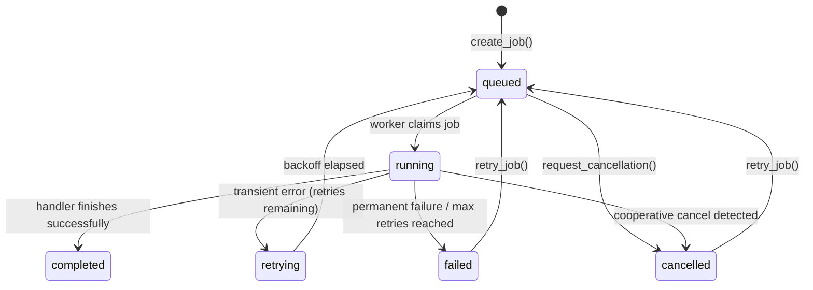

# NEOMON Background Worker & Job Engine Operations Guide

## 1. Engine Overview

NEOMON features an asynchronous background processing subsystem designed to offload long-running, CPU-intensive, or multi-stage operations from request cycles:
- Investigation execution and evidence ingestion
- Autonomous workflow multi-cycle iterations
- Dossier and cryptographic export compilation
- Provenance and quality calibration audits

Jobs are persisted in the `background_jobs` table and processed through bounded concurrency workers.

---

## 2. Job Lifecycle & Status Transitions

---

## 3. Worker Configuration & Concurrency

Workers manage execution limits using an `asyncio.Semaphore` bounded by `settings.worker_concurrency`.

| Parameter | Recommended Dev | Recommended Production | Description |
| :--- | :--- | :--- | :--- |
| `NEOMON_WORKER_CONCURRENCY` | `2` | `4 – 16` | Maximum concurrent jobs per worker process |
| `NEOMON_WORKER_POLL_INTERVAL` | `1.0s` | `0.5s` | Polling latency for new queued items |
| `NEOMON_WORKER_GRACEFUL_SHUTDOWN_TIMEOUT` | `10.0s` | `30.0s` | Maximum wait for tasks during shutdown |

---

## 4. Crash Recovery & Stale Job Detection

When a worker instance terminates unexpectedly (e.g. power loss, OOM kill, pod eviction):
1. Jobs left with `status = 'running'` are detected upon worker startup.
2. If `retry_count < max_retries`:
   - Increments `retry_count`.
   - Sets `status = 'queued'`.
   - Records recovery note in `current_step`.
3. If `retry_count >= max_retries`:
   - Sets `status = 'failed'`.
   - Records termination reason in `error_message`.

---

## 5. Cooperative Cancellation

Users with `researcher` role or higher can request cooperative cancellation:
- **API Endpoint**: `POST /api/v1/jobs/{job_id}/cancel`
- If the job is `queued`, it transitions immediately to `cancelled`.
- If the job is `running`, `cancel_requested = True` is flagged in the database. Active handlers poll `await is_cancelled()` between research stages, immediately halting execution and cleaning up intermediate state.
