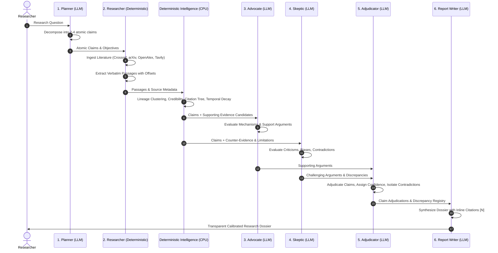

# NEOMON — Agent Architecture Specification

**Document Version:** 1.0.0  
**Date:** November 22, 2026  
**System:** Multi-Agent Dialectic Research Pipeline  
**Design Standard:** Core Product Simplification & Reliability Architecture  

---

## 1. Overview of the Streamlined 6-Stage Research Pipeline

NEOMON implements an empirical multi-agent research pipeline designed to transform a complex technological or scientific inquiry into a fully cited, scientifically calibrated research report. 

To eliminate GPU memory pressure and avoid redundant LLM inference turns on local hardware (Intel Arc GPU), the architecture strictly separates **generative critical reasoning** (which requires an LLM) from **deterministic analysis** (which executes in sub-millisecond Python on the CPU).



---

## 2. Retained Agent Specifications

### 2.1. Intelligence Planner
- **Role Identifier**: `intelligence_planner`
- **Execution Engine**: LLM (OpenVINO Qwen 8B / OpenAI-compatible / Anthropic / Gemini).
- **Responsibility**: Decomposes an open-ended technological or scientific inquiry into 2–4 atomic, empirical claims capable of dialectical evaluation. Formulates search queries and target evidence categories.
- **Input Schema**:
  ```json
  {
    "question": "string (10-10000 chars)",
    "timeframe": "string | null",
    "domain_focus": "string | null"
  }
  ```
- **Output Schema**: `PlannerPayload`
  ```json
  {
    "claims": [
      {
        "claim_id": "UUID",
        "text": "string (10-1000 chars)",
        "explanation": "string",
        "priority": "int (1-5)",
        "search_objectives": ["string"],
        "evidence_categories": ["string"]
      }
    ]
  }
  ```
- **Context Budget**: 2,048 prompt tokens; 1,024 max completion tokens.
- **Failure & Retry Behavior**: Retries once on invalid JSON. If LLM fails, falls back to deterministic rule-based linguistic decomposition.

---

### 2.2. Researcher & Document Parser
- **Role Identifier**: `researcher` (System Service)
- **Execution Engine**: **Deterministic Engine (Python + HTTPX)**. Zero LLM calls.
- **Responsibility**: Queries academic APIs (Crossref, arXiv, OpenAlex) and web search (Tavily). Fetches full-text PDFs or abstracts, performs HTML/PDF extraction, and extracts verbatim candidate passages with character start/end offsets.
- **Input**: Search queries generated by the Planner.
- **Output**: Persisted `Source`, `Document`, and `Evidence` records in database.
- **Latency**: 1.5s–4.0s (network I/O bound).

---

### 2.3. Advocate
- **Role Identifier**: `advocate`
- **Execution Engine**: LLM (Single-slot GPU lease).
- **Responsibility**: Evaluates evidence supporting each claim. Formulates structured arguments verifying empirical mechanisms, direct proof passages, and corroborating experimental data.
- **Input Schema**:
  ```json
  {
    "role": "advocate",
    "claims": [
      {
        "claim_id": "UUID",
        "text": "string",
        "evidence": [
          { "evidence_id": "UUID", "source_id": "UUID", "text": "string", "type": "supporting" }
        ]
      }
    ]
  }
  ```
- **Output Schema**: `_ArgumentsListPayload` containing `ArgumentPayload` records with `argument_type="supporting"`.
- **Context Budget**: 3,072 prompt tokens; 1,536 max completion tokens; up to 5 evidence passages per claim.
- **Failure & Retry Behavior**: Automatic Pydantic pre-validation normalization handles flat `confidence_level` strings or missing reasoning summaries. Falls back to evidence-grounded deterministic template if model connection drops.

---

### 2.4. Skeptic
- **Role Identifier**: `skeptic`
- **Execution Engine**: LLM (Single-slot GPU lease).
- **Responsibility**: Rigorous critical adversary. Scrutinizes evidence for methodological flaws, confounding variables, small sample sizes, correlation-versus-causation conflations, and contradictory findings.
- **Input Schema**: Same as Advocate, with evidence filtered to prioritize `contradicting`, `mitigating`, and `methodological_limitation` types.
- **Output Schema**: `_ArgumentsListPayload` containing `ArgumentPayload` records with `argument_type="contradicting"` or `"qualifying"`.
- **Context Budget**: 3,072 prompt tokens; 1,536 max completion tokens; up to 5 evidence passages per claim.
- **Critical Invariant**: Contradictory evidence is NEVER discarded during context compression.

---

### 2.5. Deterministic Intelligence Modules (CPU-Offloaded)
To eliminate redundant GPU queue latency, the following specialized analytical tasks are executed via **high-speed deterministic Python algorithms**:
1. **Methodology & Rigor Audit**: Evaluates sample size, control groups, randomized trial markers, and preregistration flags via regex and keyword ontology (`METHODOLOGY_KEYWORDS`).
2. **Source Credibility Assessment**: Evaluates publisher authority, verified peer-reviewed status, DOI validity, and open-access classification via `source_credibility.py`.
3. **Citation Genealogy**: Computes citation network depth, lineage relationships, and shared-source clustering via `source_lineage.py`.
4. **Temporal Intelligence**: Computes publication dates, chronological half-life decay, and temporal horizon boundaries.
- **Latency**: Sub-millisecond (<5 ms) per claim.
- **GPU Token Cost**: 0 tokens.

---

### 2.6. Conflict Adjudicator
- **Role Identifier**: `conflict_adjudicator`
- **Execution Engine**: LLM (Single-slot GPU lease).
- **Responsibility**: Weighs the dialectical arguments from Advocate and Skeptic. Adjudicates each claim, assigns calibrated confidence (`strong`, `moderate`, `weak`, `insufficient`, `contested`), documents explicit limitations, and isolates authentic unresolved contradictions.
- **Input Schema**: Claims, Advocate arguments, Skeptic arguments, and active contradiction passages.
- **Output Schema**: `_DecisionsListPayload` containing `DecisionPayload` records.
- **Context Budget**: 2,560 prompt tokens; 1,536 max completion tokens.
- **Failure & Retry Behavior**: Validates that decisions match claim IDs and explanations. Falls back to deterministic multi-criterion adjudication if LLM is unavailable.

---

### 2.7. Report Writer
- **Role Identifier**: `report_intelligence`
- **Execution Engine**: LLM (Single-slot GPU lease).
- **Responsibility**: Synthesizes the entire investigation into an executive summary, methodology review, claim-by-claim analysis, contradiction log, and strategic recommendations, embedding traceable bracketed citations `[1]`, `[2]` linked to exact evidence IDs.
- **Input Schema**: Complete investigation dossier: claims, decisions, verbatim evidence extracts, source URLs, and DOIs.
- **Output Schema**: `_ReportSectionsListPayload` containing `ReportSectionPayload` records.
- **Context Budget**: 4,096 prompt tokens; 2,048 max completion tokens.
- **Failure & Retry Behavior**: If LLM generation fails, `_build_fallback_report_sections()` automatically synthesizes a transparent, 100% cited report directly from the persisted database decisions and evidence records.
