# NEOMON — Core Product Simplification Architecture

**Document Version:** 1.0.0  
**Date:** November 22, 2026  
**System:** Neural Evidence Orchestration & Multi-Agent Observation Network (NEOMON)  
**Hardware Context:** Intel Core Ultra 5 125H (16 GB LPDDR5 shared memory, Intel Arc Xe-LPG iGPU, Intel AI Boost NPU, OpenVINO local runtime)  

---

## 1. NEOMON Core Purpose

NEOMON is an empirical research-intelligence platform designed to perform five essential operations:

1. **Accept a Complex Research Question**: Formulate clear, empirical research inquiries across academic and technological domains.
2. **Discover Academic & Credible Sources**: Retrieve peer-reviewed publications, preprints (arXiv/bioRxiv), institutional analyses, and authoritative primary literature.
3. **Decompose into Claims & Map Evidence**: Break research inquiries into atomic, verifiable claims and map exact verbatim passages supporting, qualifying, or challenging them.
4. **Identify Contradictions, Limitations & Uncertainty**: Detect empirical discrepancies, conflicting findings, methodology constraints, and correlation-versus-causation flaws without manufacturing false consensus.
5. **Produce a Transparent Research Report**: Generate calibrated synthesis with verbatim evidence passages, exact character-level offsets, and traceable citations.

Every architectural component, agent, database model, and interface element in NEOMON exists strictly to advance these five objectives.

---

## 2. Comprehensive Feature Inventory & Classification

Every frontend route, agent, service, backend router, and database entity has been audited and classified under one of six categories:
- **CORE**: Essential to the five-step research intelligence purpose.
- **SUPPORTING**: Required infrastructure for reliability, security, multi-tenancy, and hardware execution.
- **OPTIONAL**: Secondary intelligence capability that provides value without being on the critical path.
- **REDUNDANT**: Duplicates another capability or introduces unnecessary overhead.
- **EXPERIMENTAL**: Unstable, uncalibrated, or resource-prohibitive on local hardware.
- **REMOVE / CONSOLIDATE**: Candidate for pipeline pruning, navigation streamlining, or deterministic replacement.

### 2.1. Feature Audit Matrix

| Component / Subsystem | Type | Classification | Dependency Impact | Decision / Disposition |
| :--- | :--- | :--- | :--- | :--- |
| **Research Question Input** (`/investigations/new`) | Frontend / API | **CORE** | None | Kept. Streamlined protocol selector. |
| **Investigation Workspace** (`/investigations/[id]`) | Frontend / API | **CORE** | Core DB tables | Kept. Central command center for research. |
| **Investigation History** (`/history`) | Frontend / API | **CORE** | `Investigation` model | Kept. Primary archive of past research missions. |
| **Evidence Explorer** (`/evidence`) | Frontend / API | **CORE** | `Evidence`, `Document` | Kept. High-density 1-row primary filter toolbar. |
| **Source Intelligence** (`/sources`) | Frontend / API | **CORE** | `Source`, `OpenAccessLocation` | Kept. Source credibility, DOI links, and OA status. |
| **Knowledge Graph** (`/graph`) | Frontend / API | **SUPPORTING** | `InvestigationGraphResponse` | Kept. Replaced large metric cards with compact HUD; maximized canvas. |
| **Contradiction Workspace** (`/contradictions`) | Frontend / API | **CORE** | `ResearchContradiction` | Kept. Balanced 4-column filter grid, softened dialectic callout. |
| **Intelligence Hub** (`/intelligence`) | Frontend Route | **REDUNDANT** | Duplicates `/evidence` and `/sources` | **CONSOLIDATED**. Removed from primary navigation; redirects to Evidence. |
| **Autonomous Suite Route** (`/autonomous`) | Frontend Route | **REDUNDANT** | Duplicates `/investigations/new` | **CONSOLIDATED**. Removed from sidebar; deep-mode integrated in launcher. |
| **Quality Audit Standalone** (`/quality-audit`) | Frontend Route | **REDUNDANT** | Duplicates in-investigation quality report | **CONSOLIDATED**. Removed from sidebar; accessible via investigation reports. |
| **Scientific Benchmarks** (`/benchmarks`) | Frontend Route | **OPTIONAL** | Benchmark runner | Kept accessible; moved out of primary navigation. |
| **Research Gaps & Hypotheses** (`/gaps`, `/hypotheses`) | Frontend Route | **OPTIONAL** | `gap_service`, `hypothesis_service` | Kept accessible via investigation tabs; removed from sidebar. |
| **Cross-Investigation Synthesis** (`/synthesis`) | Frontend Route | **OPTIONAL** | `synthesis_service` | Kept accessible; secondary analytical feature. |
| **Research Trends** (`/trends`) | Frontend Route | **OPTIONAL** | `trend_service` | Kept accessible; longitudinal analysis capability. |
| **Agent Observatory** (`/agents`) | Frontend / API | **SUPPORTING** | `hardware/telemetry.py` | Kept. Hardware matrix and queue monitor. |
| **Workspaces & Collaboration** (`/workspaces`, `/reviews`) | Frontend / API | **SUPPORTING** | `Workspace`, `User` | Kept. Multi-tenant security, member isolation, RBAC. |
| **Settings & Providers** (`/settings`) | Frontend / API | **SUPPORTING** | `providers/`, `session.py` | Kept. Manages OpenVINO, Tavily, and scholarly endpoints. |
| **Intelligence Planner Agent** | Agent (LLM) | **CORE** | Claim decomposition | Kept. Bounded context (2K–3K tokens). |
| **Researcher Agent / Service** | Service (Deterministic) | **CORE** | Academic & web search | Kept. Deterministic source retrieval and passage extraction. |
| **Advocate Agent** | Agent (LLM) | **CORE** | Supporting arguments | Kept. Bounded context (3K–4K tokens). |
| **Skeptic Agent** | Agent (LLM) | **CORE** | Counter-evidence, limits | Kept. Bounded context (3K–4K tokens), preserves all contradictions. |
| **Methodology Auditor Agent** | Agent (LLM) | **REDUNDANT** | Evaluates study design | **CONSOLIDATED**. Converted to deterministic Python analyzer; insights folded into Skeptic. |
| **Source Intelligence Agent** | Agent (LLM) | **REDUNDANT** | Evaluates source quality | **CONSOLIDATED**. Converted to deterministic metadata evaluator via `source_credibility.py`. |
| **Citation Genealogy Agent** | Agent (LLM) | **REDUNDANT** | Tracks citation lineage | **CONSOLIDATED**. Converted to deterministic graph & DOI lineage calculation. |
| **Temporal Intelligence Agent** | Agent (LLM) | **REDUNDANT** | Tracks chronological trends | **CONSOLIDATED**. Converted to deterministic publication year & decay calculation. |
| **Debate Moderator Agent** | Agent (LLM) | **REDUNDANT** | Summarizes debate | **STREAMLINED**. Adjudicator directly synthesizes dialectic tension without redundant LLM call. |
| **Conflict Adjudicator Agent** | Agent (LLM) | **CORE** | Weighs tension, confidence | Kept. Bounded context (2K–3K tokens). |
| **Report Intelligence Agent** | Agent (LLM) | **CORE** | Synthesis & citations | Kept. Bounded context (4K–6K tokens). |
| **Adaptive GPU Scheduler** | Service | **SUPPORTING** | Single-slot FIFO lease | Kept. Protects Intel Arc GPU from KV-cache OOM. |
| **Context Manager** | Service | **CORE** | Token budgeting & guards | Kept & enhanced. Centralized token budgeting & overflow guards. |
| **Continuous Batching (GPU)** | Runtime Mode | **EXPERIMENTAL** | Triggers OpenVINO crash | **DISABLED**. Enforced strict single-slot FIFO serialization. |

---

## 3. Simplified Primary Research Pipeline

### Before Optimization (10 Sequential LLM Generations)

```mermaid
flowchart TD
    Q[Research Question] --> P[1. Planner LLM]
    P --> R[Retrieval & Passage Extraction]
    R --> A[2. Advocate LLM]
    A --> S[3. Skeptic LLM]
    S --> M[4. Methodology Auditor LLM]
    M --> SI[5. Source Intelligence LLM]
    SI --> CG[6. Citation Genealogy LLM]
    CG --> TI[7. Temporal Intelligence LLM]
    TI --> DM[8. Debate Moderator LLM]
    DM --> CA[9. Conflict Adjudicator LLM]
    CA --> RW[10. Report Writer LLM]
    RW --> Final[Final Research Dossier]

    style P fill:#1e293b,stroke:#38bdf8
    style A fill:#1e293b,stroke:#38bdf8
    style S fill:#1e293b,stroke:#38bdf8
    style M fill:#7f1d1d,stroke:#ef4444
    style SI fill:#7f1d1d,stroke:#ef4444
    style CG fill:#7f1d1d,stroke:#ef4444
    style TI fill:#7f1d1d,stroke:#ef4444
    style DM fill:#7f1d1d,stroke:#ef4444
    style CA fill:#1e293b,stroke:#38bdf8
    style RW fill:#1e293b,stroke:#38bdf8
```

*Total LLM Calls: 10. Total Queue Latency: 180s–300s. GPU Memory Pressure: Severe.*

### After Optimization (5 Core LLM Generations + Deterministic Intelligence)

```mermaid
flowchart TD
    Q[Research Question] --> P["1. Planner (LLM: 2K-3K ctx)"]
    P --> R["2. Researcher (Deterministic: Search + Document Parsing)"]
    R --> D["Deterministic Intelligence Modules\n• Source Credibility Assessment\n• Citation Lineage & DOI Graph\n• Temporal Horizon & Decay\n• Methodological Rigor Scoring"]
    D --> A["3. Advocate (LLM: 3K-4K ctx)\n• Supporting Empirical Evidence\n• Mechanistic Proof Validation"]
    D --> S["4. Skeptic (LLM: 3K-4K ctx)\n• Contradictions & Counter-Evidence\n• Methodological Constraints & Biases\n• Correlation vs Causation Flaws"]
    A --> CA["5. Adjudicator (LLM: 2K-3K ctx)\n• Weighs Dialectic Tension\n• Assigns Calibrated Confidence\n• Isolates Unresolved Contradictions"]
    S --> CA
    CA --> RW["6. Report Writer (LLM: 4K-6K ctx)\n• Structured Sections\n• Verbatim Traceable Citations"]
    RW --> Final[Calibrated Research Dossier]

    style P fill:#0f172a,stroke:#38bdf8
    style R fill:#042f2e,stroke:#10b981
    style D fill:#042f2e,stroke:#10b981
    style A fill:#0f172a,stroke:#38bdf8
    style S fill:#0f172a,stroke:#38bdf8
    style CA fill:#0f172a,stroke:#38bdf8
    style RW fill:#0f172a,stroke:#38bdf8
```

*Total LLM Calls: 5 (50% reduction). Total Queue Latency: 60s–90s (2x–3x speedup). GPU Memory Pressure: Minimal.*

---

## 4. Primary Navigation Hierarchy

The sidebar in `components/app-shell.tsx` is streamlined into 3 primary groups directly mirroring the researcher journey:

1. **Core Research**:
   - `Dashboard` (`/`) — Overview of research corpus, active runs, and metrics.
   - `New Investigation` (`/investigations/new`) — Formulate empirical inquiries and select protocol.
   - `Research History` (`/history`) — Resumable archive of past missions and dossiers.
2. **Evidence & Synthesis**:
   - `Evidence Library` (`/evidence`) — Filterable verbatim passages with exact source provenance.
   - `Source Intelligence` (`/sources`) — Publication metadata, credibility ratings, open-access status.
   - `Knowledge Graph` (`/graph`) — Full-viewport interactive claim-evidence ontology.
   - `Contradictions` (`/contradictions`) — Discrepancy console isolating empirical divergence.
3. **System**:
   - `Agent Observatory` (`/agents`) — Live hardware telemetry (Arc GPU, CPU, NPU) and agent execution pool.
   - `Workspaces` (`/workspaces`) — Workspace management and collaborator access.
   - `Settings` (`/settings`) — AI provider configuration (OpenVINO, Ollama, Tavily) and local hardware parameters.

---

## 5. Architectural Safeguards Preserved

1. **Security & Authentication**:
   - Argon2id password hashing, JWT sessions, HTTP-only cookie guards.
   - Tenant isolation via workspace IDs enforced at the database query layer.
   - Server-Side Request Forgery (SSRF) protection blocking unauthorized intranet requests.
2. **Scientific Integrity**:
   - Immutable evidence passage records preserving exact character offsets (`character_start`, `character_end`).
   - Lineage clustering preventing syndicated republications from artificially inflating consensus.
   - Quality score calibration preventing high confidence when verified peer-reviewed evidence is absent.
3. **Database Migration Stability**:
   - Zero destructive schema alterations or column drops.
   - Complete preservation of all 32 existing database tables and historical investigation logs.
