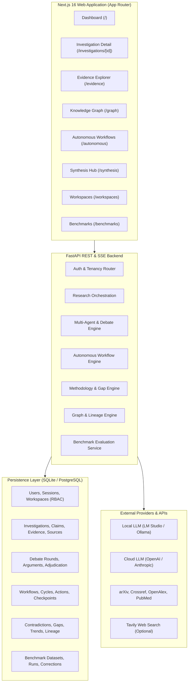

# NEOMON Feature Documentation Index

Welcome to the definitive feature documentation for **NEOMON** (*Neural Evidence Orchestration & Multi-Agent Observation Network*).

This directory provides deep, architectural, and operational documentation for every major feature implemented across the NEOMON research intelligence platform. Each document details the user-facing interface, internal execution flow, frontend components, backend endpoints, database schema, AI/external dependencies, error handling, security, and verification test suites.

---

## Complete Feature Inventory

| # | Feature Domain | Documentation | Status | Primary Interface | Backend Router | Key Tables |
|---|---|---|---|---|---|---|
| 1 | **Core Dashboard & KPI Observatory** | [dashboard.md](./dashboard.md) | Fully Implemented | `/` | `/api/v1/research` | `investigations`, `sources`, `evidence` |
| 2 | **Investigation Lifecycle & Telemetry** | [investigations.md](./investigations.md) | Fully Implemented | `/investigations/[id]`, `/investigations/new` | `/api/v1/research` | `investigations`, `research_events` |
| 3 | **Research Orchestration & Pipeline** | [research-orchestration.md](./research-orchestration.md) | Fully Implemented | Background / Engine | `/api/v1/research` | `research_queries`, `documents`, `sources` |
| 4 | **Multi-Provider AI Engine** | [ai-providers.md](./ai-providers.md) | Fully Implemented | `/settings` | `/api/v1/providers` | `model_configurations` |
| 5 | **Source Discovery & Normalization** | [source-discovery.md](./source-discovery.md) | Fully Implemented | `/sources` | `/api/v1/research` | `sources`, `documents` |
| 6 | **Evidence Explorer & Repository** | [evidence-workspace.md](./evidence-workspace.md) | Fully Implemented | `/evidence` | `/api/v1/research` | `evidence`, `claims` |
| 7 | **Evidence Quality & Calibration** | [evidence-quality.md](./evidence-quality.md) | Fully Implemented | `/quality-audit` | `/api/v1/research/quality-audit` | `source_credibility_assessments`, `research_quality_calibrations` |
| 8 | **Multi-Agent Analysis Engine** | [multi-agent-analysis.md](./multi-agent-analysis.md) | Fully Implemented | `/agents` | `/api/v1/agents`, `/api/v1/analysis` | `agents`, `agent_executions`, `analysis_jobs` |
| 9 | **Dialectical Advocate-Skeptic Debate** | [advocate-skeptic.md](./advocate-skeptic.md) | Fully Implemented | `/investigations/[id]` | `/api/v1/analysis` | `debate_rounds`, `agent_arguments`, `adjudication_decisions` |
| 10 | **Scientific Methodology Audit** | [methodology-audit.md](./methodology-audit.md) | Fully Implemented | `/investigations/[id]` | `/api/v1/research/methodology-audit` | `methodology_audit_findings` |
| 11 | **Contradiction Intelligence** | [contradiction-intelligence.md](./contradiction-intelligence.md) | Fully Implemented | `/contradictions` | `/api/v1/research/contradictions` | `research_contradictions`, `contradiction_resolution_logs` |
| 12 | **Citation Genealogy & Independence** | [citation-genealogy.md](./citation-genealogy.md) | Fully Implemented | `/investigations/[id]` | `/api/v1/research/study-independence` | `source_lineage_relationships`, `study_independence_clusters` |
| 13 | **Interactive Knowledge Graph** | [knowledge-graph.md](./knowledge-graph.md) | Fully Implemented | `/graph` | `/api/v1/research/graph` | Graph projection across 16 entity types |
| 14 | **Cross-Investigation Synthesis** | [research-synthesis.md](./research-synthesis.md) | Fully Implemented | `/synthesis` | `/api/v1/research/synthesis` | `claim_synthesis_results`, `investigation_synthesis_reports` |
| 15 | **Longitudinal Trend Intelligence** | [research-trends.md](./research-trends.md) | Fully Implemented | `/trends` | `/api/v1/research/trends` | `research_trend_analyses`, `research_trend_topics` |
| 16 | **Autonomous Gap Discovery** | [research-gaps.md](./research-gaps.md) | Fully Implemented | `/gaps` | `/api/v1/research/investigations/{id}/gaps` | `research_gap_analyses`, `research_gaps` |
| 17 | **Hypothesis Generation Engine** | [hypothesis-generation.md](./hypothesis-generation.md) | Fully Implemented | `/hypotheses` | `/api/v1/research/investigations/{id}/hypotheses` | `research_hypotheses`, `hypothesis_evaluations` |
| 18 | **Report Intelligence & Knowledge Export**| [reports-and-exports.md](./reports-and-exports.md) | Fully Implemented | `/investigations/[id]` | `/api/v1/research/export` | `report_versions`, `report_sections`, `research_reports` |
| 19 | **Autonomous Workflow Engine** | [autonomous-workflows.md](./autonomous-workflows.md) | Fully Implemented | `/autonomous` | `/api/v1/autonomous` | `autonomous_research_workflows`, `research_workflow_cycles`, `research_actions` |
| 20 | **Multi-User Collaborative Workspaces** | [workspace-collaboration.md](./workspace-collaboration.md) | Fully Implemented | `/workspaces` | `/api/v1/workspaces`, `/api/v1/collaboration` | `workspaces`, `workspace_members`, `workspace_activities`, `comments` |
| 21 | **Authentication, RBAC & Security** | [authentication-and-roles.md](./authentication-and-roles.md) | Fully Implemented | `/login`, `/register`, `/profile` | `/api/v1/auth` | `users`, `user_sessions`, `password_reset_tokens` |
| 22 | **Notification Delivery Center** | [notifications.md](./notifications.md) | Fully Implemented | `/notifications` | `/api/v1/collaboration/notifications` | `notifications`, `notification_preferences` |
| 23 | **Scientific Reliability Benchmarks** | [benchmarks.md](./benchmarks.md) | Fully Implemented | `/benchmarks` | `/api/v1/benchmarks` | `benchmark_datasets`, `benchmark_runs`, `human_evidence_corrections` |
| 24 | **Settings, Preferences & Telemetry** | [settings-and-configuration.md](./settings-and-configuration.md) | Fully Implemented | `/settings` | `/api/v1/providers`, `/api/v1/health` | `model_configurations` |
| 25 | **Complete API Endpoint Reference** | [api-reference.md](./api-reference.md) | Fully Implemented | N/A | All 25+ APIRouters | Full schema specification |
| 26 | **Database Architecture & Data Model** | [database-and-data-model.md](./database-and-data-model.md) | Fully Implemented | N/A | PostgreSQL & SQLite | 68 relational tables & Alembic migrations |

---

## Architectural Mapping

---

## Navigating Feature Documentation

Each feature document strictly follows a 17-point specification structure:
1. **Feature Overview**: High-level capability and system integration.
2. **Purpose & Problem Solved**: The concrete scientific or epistemic challenge addressed.
3. **User Access Points**: Exact URL routes, navigation elements, and dashboard cards.
4. **Step-by-Step User Workflow**: Actionable instructions from initiation to review.
5. **Internal Mechanics**: Execution algorithms, state transitions, and heuristics.
6. **Relevant Frontend Pages & Components**: Concrete TypeScript file paths.
7. **Relevant Backend Routes & Endpoints**: HTTP methods, FastAPI paths, and signatures.
8. **Relevant Services & Agents**: Python service classes, agent types, and helpers.
9. **Database Schema & Relationships**: Tables, foreign keys, and indexes involved.
10. **Inputs & Outputs**: Request payloads, response structures, and artifacts.
11. **AI Provider Dependencies**: Required model capabilities (embeddings, chat completion, structured JSON).
12. **External API Dependencies**: Academic discovery APIs, rate limits, and fallback strategies.
13. **Configuration Requirements**: Environment variables and settings toggles.
14. **Error Handling & Limitations**: Graceful degradation, error states, and operational boundaries.
15. **Security & Permission Controls**: Authentication, workspace isolation, and RBAC tiers.
16. **Related Features & Interoperability**: Upstream triggers and downstream consumers.
17. **Verification Tests**: Pytest files and frontend test suites for validation.
