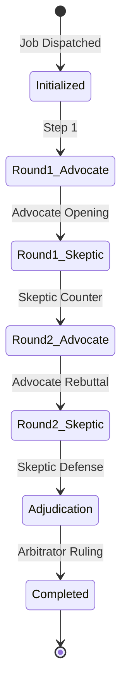

# Feature Specification: Dialectical Advocate-Skeptic Debate Engine

## 1. Feature Overview
The **Advocate-Skeptic Debate Engine** implements an adversarial dialectical evaluation loop. When an investigation completes initial literature retrieval, two opposing agents engage in structured multi-round debate: the **Advocate Agent** constructs the strongest possible evidentiary case supporting the primary hypothesis, while the **Skeptic Agent** challenges premises, identifies confounding factors, uncovers negative results, and exposes methodological limitations. An independent **Arbitrator Agent** evaluates both positions to produce an objective, balanced synthesis.

## 2. Purpose and Problem Solved
Confirmation bias is endemic in AI-generated research. When queried about a hypothesis, an LLM typically lists supporting points while neglecting contradictory findings or methodological caveats. The Advocate-Skeptic engine structurally enforces counter-evidence discovery:
- Guaranteed adversarial scrutiny for every research finding.
- Skeptic agent actively queries the database for refuting evidence.
- Both sides cite explicit evidence passages with confidence scores.
- The final adjudication grades the strength of evidence without taking a predetermined side.

## 3. Where Users Access It
- **In-Investigation**: "Multi-Agent Intelligence" tab on `/investigations/[id]`.
- **Trigger**: Click **"▶ Launch Autonomous Analysis & Debate"**.
- **Historical Transcripts**: Under the Debate Rounds accordion on completed investigations.

## 4. Step-by-Step User Workflow
1. Open an investigation on `/investigations/[id]`.
2. Navigate to the **Multi-Agent Intelligence** tab.
3. Click **"▶ Launch Autonomous Analysis & Debate"**.
4. The system initializes a multi-round debate job:
   - **Round 1 (Opening Arguments)**:
     - Advocate outlines the primary scientific claim and cites supporting literature passages.
     - Skeptic identifies missing controls, small sample sizes, or conflicting trial results.
   - **Round 2 (Rebuttal & Cross-Examination)**:
     - Advocate responds to Skeptic's challenges, clarifying dosage, sub-populations, or study designs.
     - Skeptic highlights remaining unexplained variance and potential publication bias.
   - **Adjudication**:
     - Arbitrator reviews both arguments, grades evidence strength, identifies remaining evidence gaps, and produces the final consensus recommendation.
5. Expand individual rounds to inspect argument premises, cited evidence quotes, and confidence scores.

## 5. How the Feature Works Internally

1. The analysis service creates a `debate_rounds` record for each round.
2. In each round, agents receive the current claim, extracted evidence pool, and prior round arguments.
3. Agent outputs are parsed as structured `AgentArgument` objects containing:
   - `argument_type` (`proponent` | `adversarial` | `synthesis`)
   - `premises` (list of logical statements)
   - `evidence_citations` (linked `evidence_id` references)
   - `confidence_score` (0.0 to 1.0)
4. The Arbitrator synthesizes arguments into an `adjudication_decisions` record specifying:
   - `adjudicated_status` (`confirmed`, `refuted`, `inconclusive`, `qualified`)
   - `evidence_strength` (`strong`, `moderate`, `weak`)
   - `consensus_summary` (balanced executive summary)

## 6. Relevant Frontend Pages and Components
- `app/investigations/[id]/page.tsx`: Houses the debate execution trigger and transcript view.
- `components/agent-observatory.tsx`: Shows real-time agent memory and token costs during debate.
- `components/contradiction-workspace.tsx`: Surfaces contradictions highlighted during debate rounds.

## 7. Relevant Backend Routes and Endpoints
- `POST /api/v1/analysis/jobs`: Initiates a debate job for a given investigation.
- `GET /api/v1/analysis/jobs/{job_id}/debate`: Returns full debate transcripts, rounds, and arguments.
- `GET /api/v1/analysis/jobs/{job_id}/adjudication`: Returns final arbitrator ruling.

## 8. Relevant Services and Agents
- `app.analysis.debate_service`: Coordinates round transitions and turn-taking.
- `app.agents.advocate`: Constructs pro-hypothesis arguments.
- `app.agents.skeptic`: Constructs counter-arguments and identifies limitations.
- `app.agents.arbitrator`: Impartial adjudication judge.

## 9. Database Tables and Relationships
- `analysis_jobs`: Parent container for the debate job.
- `debate_rounds`: Tracks sequential rounds (`id`, `job_id`, `round_number`, `status`).
- `agent_arguments`: Individual arguments generated per round (`id`, `round_id`, `agent_id`, `argument_text`, `evidence_citations_json`).
- `adjudication_decisions`: Final ruling linked to `job_id`.

## 10. Inputs and Outputs
- **Input**: `investigation_id` (UUID), `rounds` (int, default: 2, max: 5).
- **Output (`DebateJobResponse`)**:
  Full transcript including rounds array, agent arguments array with citations, and adjudication ruling object.

## 11. AI Provider Dependencies
- Supports both local and cloud LLMs.
- In Rule-Based Execution mode, the engine produces deterministic dialectical arguments based on evidence polarity heuristics.

## 12. External API Dependencies
None. Debate operates strictly over evidence already retrieved and verified in the local database.

## 13. Configuration Requirements
- `NEOMON_ANALYSIS_OVERALL_TIMEOUT_SECONDS`: Total debate timeout (default: 1800s).

## 14. Error Handling and Limitations
- **Argument Generation Failure**: If an agent fails to output structured JSON, the debate engine re-prompts once with a simplified schema before applying fallback deterministic extraction.
- **Round Deadlock**: If rounds exceed the maximum ceiling, the arbitrator forces a ruling based on arguments accumulated so far.

## 15. Security and Permission Considerations
- Debate initiation requires workspace write access (`researcher` or `admin`).
- Prompts enforce strict formatting instructions to prevent adversarial injections embedded within retrieved papers from hijacking agent roles.

## 16. Related Features and Dependencies
- **Methodology Audit** (`docs/features/methodology-audit.md`): Feeds statistical power and sample size audits directly to the Skeptic agent.
- **Report Intelligence** (`docs/features/reports-and-exports.md`): Debate transcripts are embedded into exportable dossiers.

## 17. Relevant Tests and How to Run Them
- **Backend Tests**:
  - `python -m pytest backend/tests/test_analysis_engine.py -q`
  - `python -m pytest backend/tests/test_agents.py -q`
