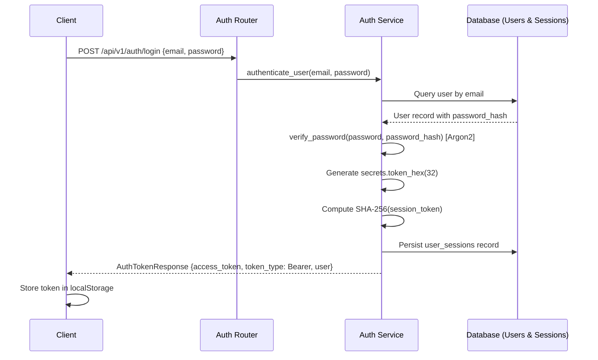

# Feature Specification: Authentication, RBAC & Security Infrastructure

## 1. Feature Overview
NEOMON implements a hardened authentication and identity infrastructure. It features email/password registration, cryptographic password hashing via **Argon2**, stateful cryptographic session management, **Role-Based Access Control (RBAC)**, brute-force rate limiting, password reset flows, and single-use Server-Sent Event (SSE) stream tickets.

## 2. Purpose and Problem Solved
Research intelligence platforms store proprietary scientific hypotheses, unpublished trial data, and strategic competitive literature reviews. Unsecured access or weak authentication risks intellectual property leaks and data corruption. NEOMON solves this through:
- Modern, memory-hard Argon2id password hashing resistant to GPU cracking.
- Cryptographically random session tokens with SHA-256 token hashing in the database.
- Granular RBAC ensuring team members only access capabilities matching their role.
- Leaky-bucket rate limiters on authentication endpoints preventing brute-force password guessing.
- Short-lived single-use stream tickets preventing token leakage in browser URL histories during SSE connections.

## 3. Where Users Access It
- **Registration**: `/register` (New user account creation).
- **Login**: `/login` (User sign-in).
- **Password Reset**: `/forgot-password` (Self-service recovery).
- **Profile & Security**: `/profile` (User profile and password changes).
- **Header Profile Badge**: Top right corner of all pages with user initials, role tag, and logout trigger.

## 4. Step-by-Step User Workflow
1. **Registration**:
   - Navigate to `/register`.
   - Enter Email address, Password (minimum 8 characters, maximum 128 characters), and Display Name.
   - Click **"Create Account"**.
   - The platform creates the user account, provisions a personal workspace (`<Name>'s Workspace`), generates an active session token, and logs the user in immediately.
2. **Sign In**:
   - Navigate to `/login`.
   - Enter credentials and submit.
   - On success, the session token is stored in `localStorage` under `neomon_session_token` and the active workspace is bound in local state.
3. **Change Password**:
   - Navigate to `/profile`.
   - Enter old password and new password.
   - Submitting invalidates previous user sessions, requiring re-login for security.
4. **Sign Out**:
   - Click user profile menu in header → **"Sign Out"**.
   - Calls backend `/api/v1/auth/logout` to revoke the database session record and clears client storage.

## 5. How the Feature Works Internally


## 6. Relevant Frontend Pages and Components
- `app/login/page.tsx`: Sign-in form with error alerts and links to register.
- `app/register/page.tsx`: Account creation form.
- `app/forgot-password/page.tsx`: Self-service reset trigger.
- `app/profile/page.tsx`: Profile inspection and password management.
- `lib/auth-context.tsx`: Client-side authentication provider and state machine.

## 7. Relevant Backend Routes and Endpoints
- `POST /api/v1/auth/register`: Creates user account and default workspace.
- `POST /api/v1/auth/login`: Validates credentials and issues session token.
- `POST /api/v1/auth/logout`: Revokes active session.
- `GET /api/v1/auth/me`: Returns currently authenticated user profile.
- `POST /api/v1/auth/change-password`: Updates password and revokes existing sessions.
- `POST /api/v1/auth/stream-ticket`: Issues single-use token for SSE connections.

## 8. Relevant Services and Agents
- `app.auth.auth_service.AuthService`: Authentication, password hashing, and session management.
- `app.auth.dependencies.get_current_user`: FastAPI dependency injecting the authenticated `User`.
- `app.auth.rate_limiter.rate_limit_auth`: Leaky-bucket IP rate limiter.

## 9. Database Tables and Relationships
- `users`: User entity storing `id`, `email`, `password_hash`, `display_name`, `role`, `status`, `created_at`.
- `user_sessions`: Active session records storing `id`, `user_id`, `session_token_hash`, `user_agent`, `expires_at`.
- `password_reset_tokens`: Reset tokens with expiration and single-use flags.
- `workspaces` and `workspace_members`: Linked via `users.id`.

## 10. Inputs and Outputs
- **Register Request (`UserRegisterRequest`)**:
  ```json
  {
    "email": "user@example.com",
    "password": "Password123!",
    "display_name": "Dr. Researcher"
  }
  ```
- **Login Response (`AuthTokenResponse`)**:
  ```json
  {
    "access_token": "token-hex-string",
    "token_type": "bearer",
    "user": {
      "id": "UUID",
      "email": "user@example.com",
      "display_name": "Dr. Researcher",
      "role": "researcher",
      "status": "active"
    }
  }
  ```

## 11. AI Provider Dependencies
None.

## 12. External API Dependencies
None.

## 13. Configuration Requirements
- `NEOMON_SECRET_KEY`: Cryptographic signing secret.
- `NEOMON_RATE_LIMIT_AUTH_RPM`: Max login/register attempts per minute per IP (default: 10).
- `NEOMON_INITIAL_ADMIN_PASSWORD`: Optional environment variable to set the seeded admin's password on startup.

## 14. Error Handling and Limitations
- **Rate Limit Exceeded**: Returns HTTP 429 Too Many Requests with informative advisory message.
- **Deactivated Accounts**: Deactivated users receive clean HTTP 403 error preventing login.
- **Timing Attack Defense**: Password comparison utilizes constant-time string comparisons.

## 15. Security and Permission Considerations
- Passwords are never stored in plaintext; hashed via Argon2 with salt.
- Plaintext session tokens are never saved to the database; only SHA-256 token hashes are persisted.
- Unauthenticated requests to protected routes return HTTP 401 Unauthorized.

## 16. Related Features and Dependencies
- **Workspaces** (`docs/features/workspace-collaboration.md`): Authenticated user identity determines workspace permissions.
- **Notifications** (`docs/features/notifications.md`): Scoped to the authenticated user.

## 17. Relevant Tests and How to Run Them
- **Backend Tests**:
  - `python -m pytest backend/tests/test_workspace_api.py -q`
  - `python -m pytest backend/tests/test_rate_limiter.py -q`
- **Frontend Tests**:
  - `node --test tests/collaboration-ui.test.mjs`
