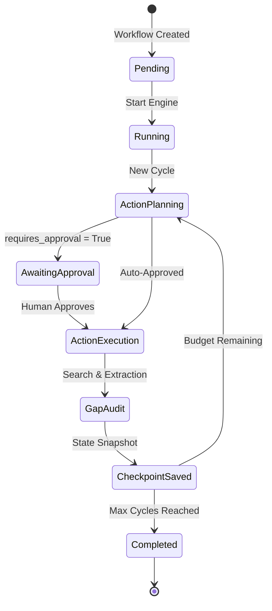

# Feature Specification: Autonomous Research Workflow Engine

## 1. Feature Overview
The **Autonomous Research Workflow Engine** (`/autonomous`) is an agentic research loop that iteratively investigates complex topics without requiring constant manual guidance. It operates across multiple cycles: formulating literature search actions, querying academic repositories, extracting evidence, auditing gaps, synthesizing state snapshots, and creating verifiable checkpoints. It features **Human-in-the-Loop Approval Gates** where critical actions require operator authorization before execution.

## 2. Purpose and Problem Solved
Standard research inquiries require researchers to manually formulate follow-up queries, evaluate gaps, and redirect search trajectories after every retrieved paper. The Autonomous Workflow Engine automates this iterative discovery process while providing governance and budget guardrails:
- Automatically formulates follow-up queries targeting identified knowledge gaps.
- Executes research cycles with explicit operational budgets (max cycles, max sources, search concurrency).
- State snapshots and checkpoints allow pausing, resuming, and rolling back workflow execution.
- Human-in-the-Loop mode pauses execution when high-cost or high-risk actions are planned, requiring human sign-off.

## 3. Where Users Access It
- **Dedicated Route**: `/autonomous` (Autonomous Research Engine Dashboard).
- **Navigation**: "Autonomous workflows" link in the primary sidebar navigation.
- **Knowledge Graph**: Autonomous workflow nodes and cycle nodes on `/graph`.

## 4. Step-by-Step User Workflow
1. Navigate to `/autonomous`.
2. Inspect the **Autonomous Engine Metrics**:
   - Active Workflows count.
   - Cycles Completed count.
   - Total Sources Acquired across workflows.
   - Engine State: `Idle`, `Running`, or `Paused (Awaiting Approval)`.
3. Click **"Launch Autonomous Research Loop"**:
   - In the configuration modal, set:
     - **Title**: e.g., *"Longitudinal Efficacy of SGLT2 Inhibitors in Heart Failure"*.
     - **Research Objective**: Clear scientific hypothesis to investigate.
     - **Execution Mode**:
       - `Supervised` (Human-in-the-loop: actions requiring approval pause the engine).
       - `Bounded Autonomous` (Runs up to budget limit without pausing).
       - `Assisted` (Pauses at every cycle boundary).
     - **Budget Limits**: Max Cycles (default: 3), Searches per Cycle (default: 5), Max Sources (default: 30), Max Duration (default: 30m).
4. Click **"Create & Initialize Workflow"**.
5. On the workflow detail card:
   - Click **"▶ Start Engine"** to begin Cycle 1.
   - Watch live cycle execution: planned actions appear in the Action Queue.
   - If an action requires approval, click **"✓ Approve"** or **"✗ Reject"** (with notes).
   - Once all cycles finish, review the generated **Autonomous Workflow Report** and executive summary.

## 5. How the Feature Works Internally

1. Creation creates an `autonomous_research_workflows` record and initializes `Cycle 1` in `research_workflow_cycles`.
2. The orchestrator plans discrete `research_actions` for the cycle (e.g. `literature_search`, `claim_extraction`, `methodology_audit`).
3. If an action's `estimated_cost` exceeds thresholds or targets sensitive keywords, `requires_approval` is set to `True` and the engine pauses in state `awaiting_approval`.
4. Upon execution, queries are logged to `research_query_histories`.
5. At the end of each cycle, the engine saves a complete JSON snapshot in `research_workflow_checkpoints`.
6. When cycles conclude, a final `research_workflow_reports` summary is compiled.

## 6. Relevant Frontend Pages and Components
- `app/autonomous/page.tsx`: Full Autonomous Workflows dashboard.
- `components/autonomous-research-workspace.tsx`: Core workflow cards, cycle timeline, action approval drawer, and launcher modal.
- `components/graph-detail-panel.tsx`: Workflow and action node inspector.

## 7. Relevant Backend Routes and Endpoints
- `GET /api/v1/autonomous/workflows`: Lists workflows for the active workspace.
- `POST /api/v1/autonomous/workflows`: Creates and initializes a new autonomous research workflow.
- `POST /api/v1/autonomous/workflows/{id}/start`: Starts or resumes execution.
- `POST /api/v1/autonomous/workflows/{id}/pause`: Pauses active execution.
- `POST /api/v1/autonomous/workflows/{id}/actions/{action_id}/approve`: Approves a pending action.
- `POST /api/v1/autonomous/workflows/{id}/actions/{action_id}/reject`: Rejects an action with notes.
- `GET /api/v1/autonomous/workflows/{id}/report`: Retrieves the final synthesized workflow report.

## 8. Relevant Services and Agents
- `app.analysis.autonomous_workflow_service.AutonomousWorkflowService`: Core state machine, cycle controller, and action scheduler.
- `app.agents.decomposer`: Formulates multi-cycle research strategies.
- `app.research.retrieval`: Executes planned search actions across providers.

## 9. Database Tables and Relationships
- `autonomous_research_workflows`: Workflow container (`id`, `workspace_id`, `investigation_id`, `title`, `objective`, `mode`, `status`, `current_cycle`, `max_cycles`, `budget_limits_json`).
- `research_workflow_cycles`: Individual cycle runs (`id`, `workflow_id`, `cycle_number`, `status`, `summary`).
- `research_actions`: Planned tasks per cycle (`id`, `workflow_id`, `cycle_id`, `action_type`, `objective`, `requires_approval`, `status`).
- `research_workflow_checkpoints`: Serialized state snapshots per cycle.
- `research_query_histories`: Normalized query execution logs.
- `research_workflow_reports`: Final synthesized reports.

## 10. Inputs and Outputs
- **Workflow Creation Request**:
  ```json
  {
    "title": "GLP-1 Weight Management Analysis",
    "research_objective": "Evaluate long-term trial evidence and cardiovascular safety.",
    "mode": "supervised",
    "max_cycles": 3,
    "searches_per_cycle": 5,
    "max_sources": 30,
    "max_duration_minutes": 30
  }
  ```
- **Response**: Fully initialized workflow entity with `Cycle 1` container and pending actions list.

## 11. AI Provider Dependencies
- Supports local (LM Studio, Ollama) and cloud (OpenAI, Anthropic) models.
- If AI providers are unavailable, the workflow engine operates in **Deterministic Mode**, executing pre-planned academic search actions without interruption.

## 12. External API Dependencies
Dispatches searches to arXiv, Crossref, OpenAlex, PubMed, and optional Tavily.

## 13. Configuration Requirements
- `NEOMON_WORKER_ENABLED`: Set to `true` for background worker processing.
- `NEOMON_WORKER_CONCURRENCY`: Parallel background worker threads (default: 4).

## 14. Error Handling and Limitations
- **Cycle Timeouts**: If a cycle exceeds duration limits, the engine saves a checkpoint and halts gracefully.
- **Action Rejection**: If a human operator rejects an action, the engine plans an alternative search path without abandoning the cycle.

## 15. Security and Permission Considerations
- Creating workflows and approving actions requires `researcher` or `admin` workspace privileges.
- Operator approval decisions log the approving user's ID for compliance tracking.

## 16. Related Features and Dependencies
- **Investigations** (`docs/features/investigations.md`): Each autonomous workflow can spawn or bind to an investigation entity.
- **Knowledge Graph** (`docs/features/knowledge-graph.md`): Workflow cycles and actions are projected into the graph canvas.

## 17. Relevant Tests and How to Run Them
- **Backend Tests**:
  - `python -m pytest backend/tests/test_autonomous_workflows.py -q`
