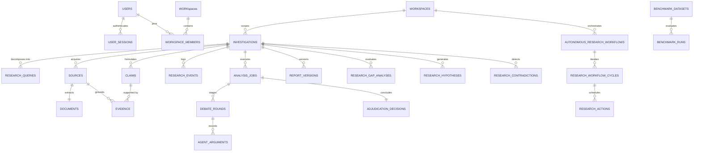

# Feature Specification: Database Architecture & Relational Data Model

## 1. Overview
NEOMON implements an enterprise relational persistence architecture designed for cross-engine portability across **SQLite** (local development with Write-Ahead Logging) and **PostgreSQL** (production deployment with asynchronous connection pooling via `asyncpg` and `psycopg`). The database schema contains **68 relational tables** managed through a sequential 16-migration Alembic chain.

---

## 2. Core Entity-Relationship Diagram

---

## 3. Relational Table Directory (68 Tables)

### A. Authentication, Identity & Tenancy (8 Tables)
1. `users`: Core user accounts (email, argon2 password_hash, display_name, role, status).
2. `user_sessions`: Active user sessions (user_id, session_token_hash, user_agent, expires_at).
3. `password_reset_tokens`: Self-service recovery tokens with expiration and single-use flags.
4. `workspaces`: Multi-tenant boundary entities (name, description, owner_id).
5. `workspace_members`: Tenancy membership mappings with role hierarchy (`admin`, `researcher`, `reviewer`, `viewer`).
6. `workspace_invitations`: Pending invitations with email, token, and target role.
7. `workspace_activities`: Immutable chronological audit stream of all mutations.
8. `notification_preferences`: Per-user alert delivery toggles.

### B. Core Research & Evidence Infrastructure (7 Tables)
9. `investigations`: Primary inquiry entity (question, mode, timeframe, status, workspace_id, owner_id).
10. `research_queries`: Decomposed search queries dispatched to providers.
11. `sources`: Indexed literature items (DOI, canonical_url, original_url, publisher, authors, content_hash).
12. `documents`: Ingested full-text representations, page counts, and structural headings.
13. `claims`: High-level scientific assertions derived from investigations.
14. `evidence`: Verbatim factual passages linked to claims and sources with confidence and polarity.
15. `research_events`: Real-time pipeline events streamed via SSE.

### C. Multi-Agent Analysis & Dialectical Debate (7 Tables)
16. `agents`: System agent definitions (decomposer, synthesizer, advocate, skeptic, arbitrator).
17. `model_configurations`: AI model provider endpoints (LM Studio, Ollama, OpenAI, Anthropic).
18. `agent_executions`: Individual execution runs tracking status, model used, and latency.
19. `analysis_jobs`: Parent container for multi-agent jobs.
20. `debate_rounds`: Sequential rounds of adversarial interaction.
21. `agent_arguments`: Arguments submitted by Advocate and Skeptic agents.
22. `adjudication_decisions`: Impartial rulings and evidence strength assessments.

### D. Quality Calibration & Methodology Audit (4 Tables)
23. `source_credibility_assessments`: Peer-review status, venue scoring, and credibility ratings.
24. `source_lineage_relationships`: Citation lineage links between sources (parent/child citations).
25. `evidence_claim_validations`: Inferential entailment classification and correlation/causation checks.
26. `research_quality_calibrations`: Epistemic tier calibrations (`Strong`, `Moderate`, `Preliminary`, `Challenged`).

### E. Advanced Intelligence & Discovery (12 Tables)
27. `methodology_audit_findings`: Sample size, statistical power, and bias audit findings.
28. `study_independence_clusters`: Clustered source networks detecting shared primary datasets.
29. `research_contradictions`: Intra- and cross-investigation conflicting assertions.
30. `contradiction_resolution_logs`: Formal investigator resolution records and explanations.
31. `research_gap_analyses`: Versioned evidence coverage evaluations.
32. `research_gaps`: Categorized knowledge voids with recommended queries.
33. `research_hypotheses`: Falsifiable scientific propositions with experimental designs.
34. `hypothesis_evaluations`: Feasibility and plausibility audits on hypotheses.
35. `research_trend_analyses`: Longitudinal trajectory tracking runs.
36. `research_trend_topics`: Individual topic velocities, momentum scores, and recommendations.
37. `claim_synthesis_results`: Multi-study synthesized claim themes.
38. `investigation_synthesis_reports`: Cross-investigation consensus reports.

### F. Autonomous Workflows & Background Processing (7 Tables)
39. `autonomous_research_workflows`: Multi-cycle agentic research loops.
40. `research_workflow_cycles`: Individual cycle containers.
41. `research_actions`: Scheduled and executed research actions with human approval gates.
42. `research_workflow_checkpoints`: Serialized cycle state snapshots for pause/resume.
43. `research_query_histories`: Historical query effectiveness scores.
44. `research_workflow_reports`: Final synthesized autonomous workflow dossiers.
45. `background_jobs`: Asynchronous worker tasks with progress tracking and cancel requests.

### G. Collaboration, Discussions & Notifications (6 Tables)
46. `comment_threads`: Discussion roots attached to any entity.
47. `comments`: Threaded replies within discussion threads.
48. `evidence_annotations`: Highlights and margin notes on specific evidence passages.
49. `review_requests`: Peer review assignments on investigations.
50. `review_decisions`: Peer review rulings (`approved`, `changes_requested`, `rejected`).
51. `notifications`: In-app notification records.

### H. Reports, Benchmarks & Operational Tables (17 Tables)
52. `report_versions`: Version-controlled investigation reports.
53. `report_sections`: Normalized sections within report versions.
54. `research_reports`: High-level summary entity.
55. `benchmark_datasets`: Gold-standard datasets (SciFact, PubMedQA, etc.).
56. `benchmark_runs`: Empirical evaluation runs and precision/recall scores.
57. `human_evidence_corrections`: Correction logs for challenged evidence.
58. `provider_failure_impacts`: Log of external search provider timeouts and errors.
59. `cross_investigation_relationships`: Inter-study relational links.
60. `document_version_relationships`: Document history linkages.
61. `evidence_verification_records`: Algorithmic verification timestamps.
62. `extraction_executions`: Execution traces for document parsers.
63. `search_provider_executions`: Fine-grained search provider dispatch logs.
64. `open_access_locations`: Open-access PDF and repository URLs from Unpaywall/Europe PMC.
65. `research_execution_manifests`: Cryptographic audit manifests.
66. `analysis_agent_executions`: Specialized analysis agent traces.
67. `adjudication_decisions`: (Relational link).
68. `alembic_version`: Alembic migration tracker table.

---

## 4. Alembic Migration History (0001 through 0016)

| Revision ID | Description | Key Schema Additions | Dialect Portability Strategy |
|---|---|---|---|
| `20261112_0001` | Initial Schema | `investigations`, `agents`, `model_configurations`, `agent_executions`, `research_events` | Standard ANSI SQL |
| `20261112_0002` | Index cleanup | Dropped legacy agent index | Idempotent drop |
| `20261112_0003` | Sources & Evidence | Added `research_queries`, `sources`, `documents`, `claims`, `evidence` | Portable text and UUIDs |
| `20261112_0004` | Research Quality | Added document access levels, evidence traceability | `server_default=sa.true()` |
| `20261112_0005` | Query Classification | Categorized research query dispatching | Standard columns |
| `20261112_0006` | Multi-Agent Analysis | Added `analysis_jobs`, `debate_rounds`, `agent_arguments`, `adjudication_decisions` | `server_default=sa.false()` |
| `20261112_0007` | Document Relationships | Document versioning relationships | Standard foreign keys |
| `20261112_0008` | Hypotheses | Added `research_hypotheses`, `hypothesis_evaluations` | Standard schema |
| `20261112_0009` | Research Gaps | Added `research_gap_analyses`, `research_gaps` | `server_default=sa.true()` |
| `20261113_0010` | Trend Intelligence | Added `research_trend_analyses`, `research_trend_topics` | Portable float and JSON |
| `20261113_0011` | Quality Calibration | Added `source_credibility_assessments`, `source_lineage_relationships`, `evidence_claim_validations`, `research_quality_calibrations`, `provider_failure_impacts` | **Hardened**: Portable `sa.false()` boolean defaults |
| `20261114_0012` | Autonomous Engine | Added `autonomous_research_workflows`, `research_workflow_cycles`, `research_actions`, `research_workflow_checkpoints`, `research_query_histories`, `research_workflow_reports` | **Hardened**: Portable `sa.false()` boolean defaults |
| `20261114_0013` | Workspaces (M10) | Added `users`, `user_sessions`, `workspaces`, `workspace_members`, `workspace_invitations`, `comment_threads`, `comments`, `evidence_annotations`, `review_requests`, `review_decisions`, `notifications`, `notification_preferences`, `workspace_activities` | Seeded admin user and default workspace |
| `20261114_0014` | Background Jobs | Added `background_jobs` table | `server_default=sa.false()` |
| `20261114_0015` | Scientific Reliability | Added `benchmark_datasets`, `benchmark_runs`, `human_evidence_corrections`, `methodology_audit_findings`, `study_independence_clusters` | **Hardened**: Portable `sa.false()` and `sa.true()` defaults |
| `20261114_0016` | Schema Alignment | Aligned live schema, index names, report versioning | **Hardened**: Dialect branching for foreign keys without table recreate; idempotent index creation |

---

## 5. PostgreSQL & SQLite Portability Guarantees

1. **Boolean Columns**: Every boolean column specifies `server_default=sa.false()` or `server_default=sa.true()`. This compiles to `BOOLEAN DEFAULT false` / `true` on PostgreSQL and `BOOLEAN DEFAULT 0` / `1` on SQLite, completely preventing `psycopg.errors.DatatypeMismatch`.
2. **Foreign Key Alterations**: Migration `0016` uses dialect branching: on SQLite it uses `batch_alter_table` to reconstruct table structures, while on PostgreSQL it executes native `ALTER TABLE ... ADD CONSTRAINT` commands, avoiding table drop locks on active foreign keys.
3. **Connection Pooling**:
   - **SQLite**: Configured with `WAL` (Write-Ahead Logging), 30-second busy timeout, and `NullPool`.
   - **PostgreSQL**: Configured with `asyncpg` or `psycopg`, connection pooling (`pool_size=10`, `max_overflow=20`), and `pool_pre_ping=True` to discard stale connections automatically.
