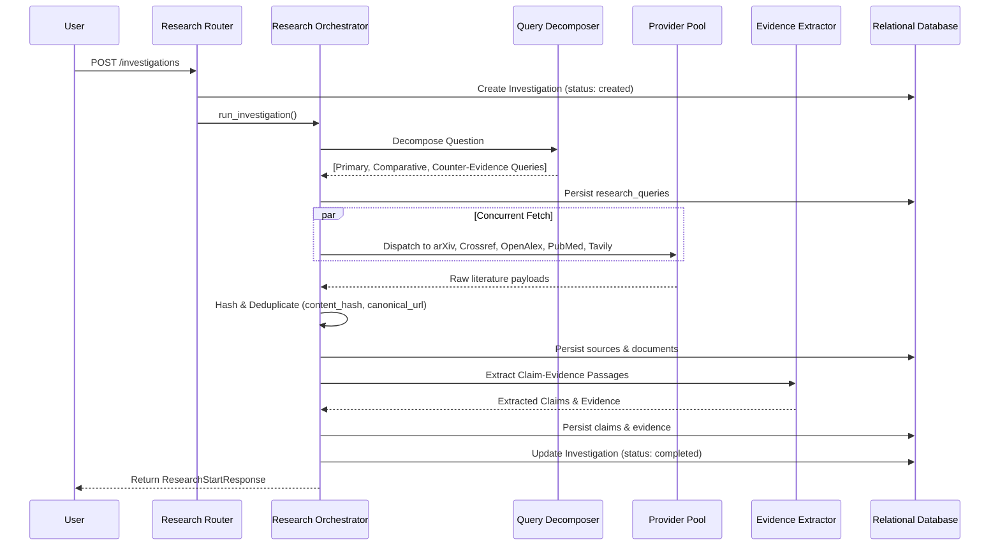

# Feature Specification: Research Orchestration & Pipeline Architecture

## 1. Feature Overview
The **Research Orchestration Engine** is the backbone computational pipeline of NEOMON. It coordinates the transformation of an open-ended research question into an evidence-backed intelligence report through a multi-stage, deterministic pipeline: question decomposition, multi-provider literature retrieval, document canonicalization, passage extraction, evidence verification, and citation linking.

## 2. Purpose and Problem Solved
Literature reviews in modern research are bottlenecked by manual query formulation across fragmented search engines, slow reading of irrelevant papers, and confirmation bias. The Research Orchestrator automates this lifecycle while preserving absolute scientific rigor:
- Formulates multi-angle search queries covering mechanisms, clinical efficacy, and counter-evidence.
- Distributes queries concurrently across academic repositories and web search providers.
- Computes SHA-256 cryptographic hashes for retrieved documents to prevent content tampering.
- Deduplicates sources by canonical URL, DOI, and text similarity.

## 3. Where Users Access It
The orchestrator operates as a background service triggered when an investigation is launched from:
- Dashboard Quick Launcher (`/`)
- Advanced Investigation Creator (`/investigations/new`)
- Autonomous Workflow Engine cycles (`/autonomous`)

## 4. Step-by-Step User Workflow
1. User enters a research query and selects `Quick` or `Deep` mode.
2. The orchestrator decomposes the question into categorized sub-queries:
   - Primary: Core mechanism and intervention terms.
   - Comparative: Existing standard-of-care comparisons.
   - Adversarial: Known counter-indications, adverse effects, and methodology limitations.
3. Queries execute in parallel across active providers.
4. Raw payloads are normalized into uniform `Document` models with title, abstract, full text, and DOI.
5. Verifiable evidence passages are extracted and linked to claims.
6. The orchestrator updates the investigation status to `completed` and broadcasts completion events.

## 5. How the Feature Works Internally

## 6. Relevant Frontend Pages and Components
- `app/investigations/[id]/page.tsx`: Displays orchestrator execution stages and live event telemetry.
- `components/agent-observatory.tsx`: Visualizes agent task execution and memory state.

## 7. Relevant Backend Routes and Endpoints
- `POST /api/v1/research/investigations`: Triggers synchronous initiation and background orchestration.
- `GET /api/v1/events/investigations/{id}`: Streams orchestrator milestones (e.g. `query_generated`, `source_discovered`, `evidence_extracted`).

## 8. Relevant Services and Agents
- `app.research.service.run_investigation`: Core entrypoint managing transaction boundaries and pipeline flow.
- `app.research.decomposition.Decomposer`: Rule-based and LLM-assisted question decomposer.
- `app.research.retrieval.retrieve_document`: Multi-provider dispatch engine with retry logic and timeouts.
- `app.research.normalization.content_hash`: Cryptographic SHA-256 hash generator.

## 9. Database Tables and Relationships
- `investigations`: Tracks high-level pipeline status and mode.
- `research_queries`: Generated search queries, categorizations, and dispatch timestamps.
- `sources`: Acquired research literature metadata (DOI, canonical URL, publisher, authors).
- `documents`: Raw textual content, page counts, and headings extracted from sources.
- `claims`: Extracted factual assertions.
- `evidence`: Specific sentences or paragraphs grounding claims.

## 10. Inputs and Outputs
- **Inputs**: `InvestigationCreate` schema specifying `question`, `mode` (`quick` | `deep`), and optional `timeframe`.
- **Outputs**: `ResearchStartResponse` containing the initialized investigation, executed query list, initial counts, and error manifests.

## 11. AI Provider Dependencies
- Supports rule-based fallback when AI providers are unavailable.
- When an AI provider (LM Studio, Ollama, OpenAI) is configured, the orchestrator utilizes structured JSON prompting for query decomposition and deep claim extraction.

## 12. External API Dependencies
- Public APIs:
  - arXiv API (`export.arxiv.org`)
  - Crossref REST API (`api.crossref.org`)
  - OpenAlex API (`api.openalex.org`)
  - Europe PMC / PubMed Central API (`api.europepmc.org`)
- Optional Web API:
  - Tavily Search API (`api.tavily.com`) if configured.

## 13. Configuration Requirements
- `NEOMON_REQUEST_TIMEOUT_SECONDS`: Maximum latency per provider query (default: 15.0s).
- `NEOMON_RESEARCH_USER_AGENT`: User-agent string identifying the platform to academic APIs.
- `NEOMON_RESEARCH_MAX_DOCUMENT_BYTES`: Maximum size for fetched PDF/HTML documents (default: 5MB).

## 14. Error Handling and Limitations
- **External Provider Outages**: If a provider returns 429, 500, or times out, the orchestrator catches the exception, logs it to `provider_failure_impacts`, and continues with remaining providers.
- **Malformed Documents**: Unparseable PDFs or binary payloads are flagged as `metadata_only` without interrupting pipeline execution.

## 15. Security and Permission Considerations
- SSRF Prevention: Document fetchers validate destination URLs, restricting local loopback addresses (`127.0.0.1`, `localhost`) unless explicitly allowed via `NEOMON_ALLOWED_LOCAL_PROVIDER_HOSTS`.
- Content Integrity: Verifies SHA-256 content hashes to detect upstream document mutations.

## 16. Related Features and Dependencies
- **Evidence Quality Calibration** (`docs/features/evidence-quality.md`): Calibrates credibility for all acquired sources.
- **Knowledge Graph** (`docs/features/knowledge-graph.md`): Visualizes sources and claims produced by the orchestrator.

## 17. Relevant Tests and How to Run Them
- **Backend Tests**:
  - `python -m pytest backend/tests/test_research_engine.py -q`
  - `python -m pytest backend/tests/test_providers.py -q`
  - `python -m pytest backend/tests/test_provider_concurrency.py -q`
