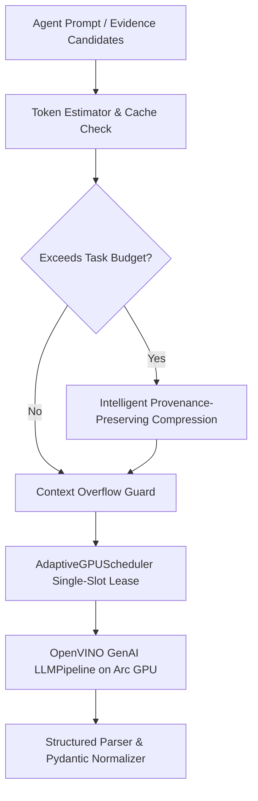

# NEOMON — OpenVINO Context & Multi-Agent Inference Optimization

**Document Version:** 1.0.0  
**Date:** November 22, 2026  
**Hardware Platform:** Intel Core Ultra 5 125H (14 Cores / 18 Threads)  
**Memory:** 16 GB LPDDR5-7467 Dual-Channel Unified Shared Memory (USM)  
**Primary Accelerator:** Intel Arc Graphics (Xe-LPG integrated GPU, 7 Xe-cores, 112 EUs)  
**Auxiliary Accelerator:** Intel AI Boost NPU (2 NPU Compute Engines)  
**Inference Engine:** OpenVINO GenAI 2024.5 / OpenAI-compatible Uvicorn API  
**Target Model:** `openvino-qwen3-8b` (`Qwen2.5-7B-Instruct-int4-ov`, INT4 dynamic quantization)  

---

## 1. Hardware Architecture & Memory Constraints

On the Intel Core Ultra 5 125H, system memory is unified (LPDDR5 shared between CPU, Arc iGPU, and NPU). When running an 8B INT4 quantized LLM:
- **Base Model Weights in USM**: ~4.2 GB.
- **OpenCL Runtime & Shader Kernel Cache**: ~450 MB.
- **Operating System & Backend Runtime**: ~3.8 GB.
- **Available Headroom for KV-Cache & Matrix Scratchpads**: ~7.5 GB.

### Critical Constraint: The Shared KV-Cache Trap
In an unmanaged 16K context window with multi-agent concurrency, every 1,000 prompt tokens allocates approximately 128 MB of KV-cache memory in the Xe-LPG USM arena. 
- Attempting concurrent `.generate()` calls on the same OpenVINO pipeline triggers unrecoverable `can_allocate_blocks(1)` allocator panics.
- Unconstrained context broadcasting (sending all 40+ retrieved passages to every specialist agent) generated prompts exceeding 25,000 tokens, degrading Time to First Token (TTFT) to >180 seconds.

---

## 2. Centralized Context Manager Architecture

NEOMON enforces a centralized context budgeting and token management engine located in `backend/app/analysis/context_manager.py`:

### 2.1. Calibrated Context Targets by Agent Task

Rather than assigning a uniform 16K window to all agents, NEOMON defines task-specific context targets calibrated to Intel Arc GPU latency curves:

| Agent Task | Target Prompt Tokens | Max Completion Tokens | Max Evidence / Claim | Preserve Full Text | Primary Focus |
| :--- | :---: | :---: | :---: | :---: | :--- |
| **Intelligence Planner** | 2,048 | 1,024 | 0 | False | Research question decomposition into 2–4 atomic claims. |
| **Advocate** | 3,072 | 1,536 | 5 | False | Supporting empirical mechanisms and direct proof passages. |
| **Skeptic** | 3,072 | 1,536 | 5 | False | Contradictions, limitations, biases, correlation vs causation. |
| **Methodology Auditor** | 3,072 | 1,536 | 5 | False | Study design, sample size, control groups (Deterministic / LLM). |
| **Conflict Adjudicator** | 2,560 | 1,536 | 5 | False | Resolving dialectic tension, assigning calibrated confidence. |
| **Report Writer** | 4,096 | 2,048 | 6 | False | Final multi-section synthesis with verbatim traceable citations. |
| **Default Profile** | 2,560 | 1,536 | 4 | False | General fallback. |

---

## 3. Compact Context Policy & Provenance Preservation

To prevent KV-cache bloat without degrading scientific rigor, the context manager enforces a strict compact context policy:

### Sent to Each Agent:
1. The original research inquiry.
2. The specific atomic claim under evaluation.
3. The agent's explicit analytical role.
4. The minimum essential source metadata (title, author, venue, year, DOI).
5. The top-ranked claim-specific evidence passages (up to the role budget).
6. Competing arguments from prior dialectic rounds.
7. Active unresolved contradictions.

### Stripped from Context:
1. Redundant full-text source document bodies (>2,000 words).
2. Duplicate or near-duplicate passages from syndicated feeds.
3. Unrelated claims outside the agent's current focus.
4. Generic boilerplate system prompts.
5. Large conversation histories.

### Immutable Provenance Invariants:
The compression engine (`validate_and_enforce_context_bounds`) is strictly forbidden from truncating:
- Exact verbatim passage text.
- Source IDs, URLs, and DOIs.
- Claim UUIDs.
- Evidence polarity tags (`supporting`, `contradicting`, `mitigating`).

---

## 4. Staged Evidence Retrieval & Relevance Caching

1. **Passage Relevance Caching**:
   `get_cached_relevance()` and `set_cached_relevance()` maintain an in-memory thread-safe dictionary mapping `(claim_text, evidence_text)` hashes to their semantic alignment scores. Re-evaluations across Advocate, Skeptic, and Adjudicator reuse pre-computed alignment scores, eliminating redundant matrix multiplications.
2. **Deterministic Role Filtering**:
   - `advocate`: Selects highest-relevance `supporting` passages.
   - `skeptic`: Guarantees inclusion of ALL `contradicting`, `mitigating`, and `methodological_limitation` passages before considering supporting items. Strong contradictions are never discarded.
   - `conflict_adjudicator`: Prioritizes conflicting evidence pairs to expose disagreements directly to the adjudicator.

---

## 5. Single-Slot GPU Queue Scheduling (`AdaptiveGPUScheduler`)

`backend/app/analysis/scheduler.py` coordinates GPU execution:
- **Max Concurrent Slots**: Strictly 1.
- **Fair FIFO Queue**: Agents queue in arrival order with bounded timeouts (300 seconds default).
- **Graceful Cancellation**: When an investigation is cancelled, the lease context manager intercepts `asyncio.CancelledError`, immediately decrements `_queue_depth`, purges the request ID from the pending queue, and releases the single-slot lock.
- **CPU Offloading**: While one agent holds the GPU matrix engine, other agents prepare their prompts, rank evidence, and parse JSON on the Intel Core Ultra CPU cores asynchronously.
