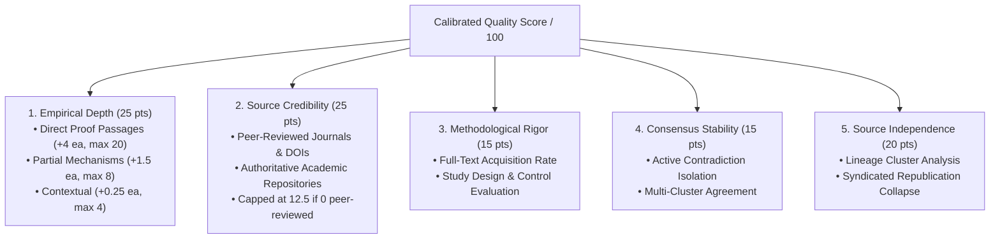

# NEOMON — Scientific Validation, Entailment & Quality Calibration

**Document Version:** 1.0.0  
**Date:** November 22, 2026  
**System:** Empirical Evidence Scoring & Integrity Gate Architecture  

---

## 1. Principles of Scientific Integrity in NEOMON

NEOMON is built on the scientific foundation that **relevance is not evidence, correlation is not causation, and paper count is not consensus**.

### Strict Evidence Categorization
Every extracted passage is categorized into one of five rigorous empirical classifications:

1. **Direct Support (`direct_support`)**:
   Passage articulates explicit, demonstrable empirical findings, measured data, or proven causal mechanisms that directly entail the claim.
2. **Partial Support (`partial_support`)**:
   Passage substantiates an intermediate causal step, sub-claim, or component mechanism, but requires supplementary corroboration to establish the full conclusion.
3. **Contextual Relevance (`contextual_support`)**:
   Passage mentions relevant entities, technological context, or descriptive background without providing mechanistic proof or measured findings.
4. **Contradiction (`direct_contradiction`)**:
   Passage provides empirical data or peer-reviewed findings that refute, challenge, or directly conflict with the claim.
5. **Insufficient Evidence (`insufficient_evidence`)**:
   Passage has inadequate lexical/semantic overlap (<15%), is too brief (<15 characters), or lacks empirical data.

---

## 2. Rigorous Anti-Hallucination & Anti-Conflation Safeguards

NEOMON implements algorithmic safeguards in `backend/app/analysis/entailment_service.py` to prevent common scientific evaluation errors:

### 2.1. Study Intent vs. Empirical Findings
- **The Problem**: Academic abstracts frequently state intent ("In this paper, we aim to demonstrate that X causes Y"). Naive AI systems read this thesis statement and classify it as proof that X causes Y.
- **NEOMON Safeguard**: `_STUDY_INTENT_PHRASES` regex flags phrases such as *"aims to"*, *"hypothesized that"*, *"sought to explore"*. If a passage contains study intent without empirical result phrases (*"measurements revealed"*, *"statistically confirmed"*, *"data demonstrated"*), it is strictly capped at **Contextual Relevance** and denied Direct Support classification.

### 2.2. Correlation vs. Causation
- **The Problem**: Observational literature frequently notes concurrent events ("A occurred alongside B during 2024"). Naive systems infer that A caused B.
- **NEOMON Safeguard**: `_CORRELATIONAL_PHRASES` detects associative markers (*"associated with"*, *"coincided with"*, *"in tandem with"*). When a causal claim is evaluated against purely correlational evidence, the `correlation_vs_causation_flag` is tripped, downgrading the finding and appending an explicit methodological warning.

### 2.3. Authentic Contradiction Preservation
- **The Problem**: LLMs possess an innate bias toward consensus and often paper over opposing scientific results.
- **NEOMON Safeguard**: The `_CONTRADICTION_PHRASES` engine isolates refutations. When a contradiction is detected, it is registered in `ResearchContradiction` with its opposing thesis and antithesis passages. Contradictions are permanently preserved until empirical boundary conditions (different populations, differing measurement tools, or time periods) are documented.

---

## 3. Calibrated 5D Quality Scoring Architecture

Rather than assigning high quality scores based simply on the quantity of sources or completed agent executions, `backend/app/analysis/quality_calibration_service.py` evaluates investigations across **5 orthogonal scientific dimensions** (Total: 100 points):

---

## 4. Strict Quality Tier Boundaries & Gating Invariants

An investigation's quality tier is strictly constrained by empirical prerequisites. **Zero score inflation is permitted.**

### Prerequisites for "Very Strong" (Score ≥ 85.0):
1. Calibrated score ≥ 85.0 / 100.
2. Research coverage ≥ 80.0%.
3. **Direct empirical proof passages ≥ 2**.
4. **Verified peer-reviewed publications ≥ 1**.
5. **Zero unresolved critical retrieval failures**.
6. **Zero active unadjudicated contradictions**.
*If any prerequisite fails, the tier is forcefully downgraded to Strong or Moderate.*

### Prerequisites for "Strong" (Score ≥ 70.0):
1. Calibrated score ≥ 70.0 / 100.
2. Research coverage ≥ 60.0%.
3. **Direct proof ≥ 1 OR (partial mechanisms ≥ 2 AND verified peer-reviewed ≥ 1)**.
4. Zero unresolved critical retrieval failures.
5. Zero unadjudicated contradictions.
*If the corpus relies purely on secondary web articles with zero direct proof, the tier is capped at Moderate.*

### Criteria for "Insufficient Evidence":
If total evidence passages = 0, relevant source count = 0, or calibrated score < 30.0, the investigation is classified as `insufficient_evidence`. NEOMON never manufactures artificial conclusions when empirical grounding is missing.
